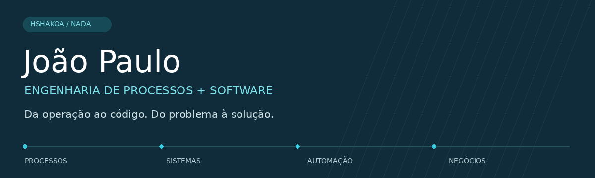

  

<h1 align="center">João Paulo Araújo Passos</h1>

<strong>Engenharia de Processos · Desenvolvimento de Sistemas · Fundador da NADA Studio</strong>

  <a href="https://www.nadastudio.com.br">Conheça a NADA Studio ↗</a> &nbsp;·&nbsp;
  <a href="https://github.com/nada-studio-br">Projetos da empresa</a> &nbsp;·&nbsp;
  <a href="#projetos-abertos">Explore meus projetos</a>

---

### Entendo o processo. Construo a ferramenta.

Sou profissional de Engenharia de Processos e estudante de Engenharia de Produção, em Jundiaí–SP. Desenvolvo software a partir de problemas que encontro na operação: tarefas repetitivas, informações dispersas, falta de rastreabilidade e controles manuais.

Na **[NADA Studio](https://www.nadastudio.com.br)**, conecto essa experiência à criação de sites, sistemas e automações para empresas. Meu trabalho une análise do problema, implementação, testes e documentação.

| Engenharia e operação | Software e automação | Negócios digitais |
| :--- | :--- | :--- |
| Melhoria e padronização de processos | Sistemas web e ferramentas internas | Sites e experiências de conversão |
| Produção, qualidade e rastreabilidade | APIs, integrações e automações | Mensuração e análise de dados |
| Desenho técnico, dispositivos e gabaritos | Python, bancos de dados e IA aplicada | Soluções para pequenos negócios |

### Projetos abertos

| Projeto | O que você encontra |
| :--- | :--- |
| **[NADA Studio](https://github.com/HSHAKOA/nada-studio)** | Presença digital da empresa: desenvolvimento web, apresentação dos serviços e portfólio. |
| **[Transcritor de reuniões](https://github.com/HSHAKOA/Agente-de-transcrito-de-reuni-es-)** | Captura e transcrição de áudio com Python, processamento em blocos e documentação. **Licença Apache-2.0.** |
| **[Barcode Python Acadêmico](https://github.com/HSHAKOA/barcode-python-academico)** | Apontamento de produção, estoque e histórico com Code 128, Tkinter e SQLite. Edição acadêmica com dados fictícios. |
| **[Reconhecimento de gestos](https://github.com/HSHAKOA/reconhecimento-gestos-python)** | Visão computacional em tempo real com Python, OpenCV e MediaPipe. |
| **[MarkItDown Converter](https://github.com/HSHAKOA/markitdown-converter)** | Conversão de documentos para Markdown usando a biblioteca MarkItDown. |
| **[Vitrine Esporte](https://github.com/HSHAKOA/vitrine-esporte)** | Template de catálogo esportivo desenvolvido pela NADA Studio. |

<strong>Ver uma demonstração do projeto acadêmico de barcode</strong>

 

[Veja a documentação e as capturas reais →](https://github.com/HSHAKOA/barcode-python-academico#readme)

### Além dos repositórios públicos

Também desenvolvo soluções para **planejamento e controle da produção, extrusão de PVC, rastreabilidade, gestão APQP/PPAP, agendamentos e integrações comerciais**. Parte desse trabalho está em repositórios privados por envolver operações internas ou projetos de clientes.

### Ferramentas que uso

**Web:** TypeScript · JavaScript · React · Next.js · HTML · CSS  
**Automação e dados:** Python · Node.js · APIs REST · PostgreSQL · SQLite · Supabase · n8n  
**Entrega:** Git · GitHub · Cloudflare Workers · Vercel  
**Engenharia e análise:** SolidWorks · AutoCAD · Power BI · OpenCV · MediaPipe

Uso IA para apoiar desenvolvimento e automação, com revisão de código, testes e atenção ao contexto de cada aplicação.

---

### Vamos transformar um processo em uma solução?

Conheça os serviços e entre em contato pelo site da **[NADA Studio ↗](https://www.nadastudio.com.br)**.

As condições de uso de cada projeto estão na respectiva licença. A licença de um repositório não se estende aos demais projetos, marcas ou materiais de clientes.
