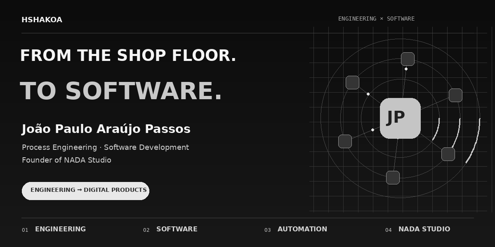
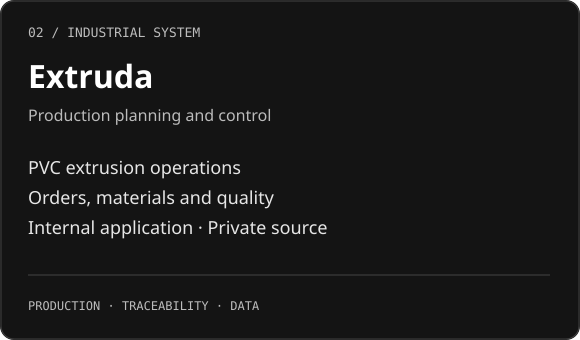
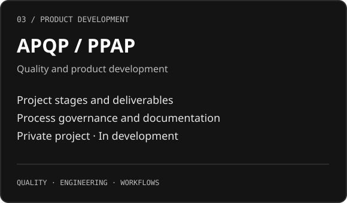
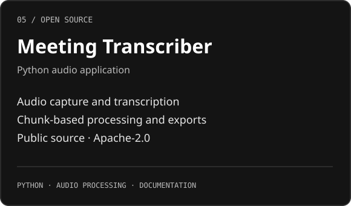

<picture><source media="(prefers-reduced-motion: reduce)" srcset="assets/hero-static.png"></picture>

<a href="https://github.com/HSHAKOA/HSHAKOA#readme"><strong>ENGLISH</strong></a> &nbsp; / &nbsp; <a href="https://github.com/HSHAKOA/HSHAKOA/blob/main/README.pt-BR.md"><strong>PORTUGUÊS</strong></a>

<a href="mailto:passosjoao@outlook.pt">EMAIL ↗</a> &nbsp;·&nbsp; <a href="https://www.linkedin.com/in/jo%C3%A3o-paulo-ara%C3%BAjo-passos-0568b9257">LINKEDIN ↗</a> &nbsp;·&nbsp; <a href="https://www.nadastudio.com.br">NADA STUDIO ↗</a> &nbsp;·&nbsp; Jundiaí, SP · Brazil

## Engineering context. Practical software.

I'm **João Paulo Araújo Passos**, a **Process Engineering professional**, **Production Engineering student** and **founder of NADA Studio**, based in **Jundiaí, São Paulo, Brazil**.

I work across industrial operations and software development: understanding the workflow, identifying repetitive work and building tools for production, quality, traceability and business operations. My experience includes technical design, manufacturing support, data analysis, web applications and automation.

## Selected impact

**Packing List — from a manual routine to an internal application.** Reported preparation time went from **7 minutes to 1 minute per packing list**. That is **6 minutes saved per document**, or **85.7% less time for this task**. This is a task-level operational result, not an estimate of total factory productivity.

The public case describes the outcome. Source code, internal documents, customer information and operational records remain private.

## Selected work

 

 

| Project | Contribution | Public access |
| :--- | :--- | :--- |
| **Packing List** | Industrial document preparation, reporting and traceability; **7 → 1 minute per document** | Outcome summary only |
| **Extruda** | Production planning and control for PVC extrusion, orders, materials and quality | Scope summary only |
| **APQP / PPAP** | Engineering and quality workflows, project stages, deliverables and documentation | Scope summary only; in development |
| **NADA Studio** | Company building, websites, systems, integrations and automation | [Website](https://www.nadastudio.com.br) · [GitHub organization](https://github.com/nada-studio-br) |
| **Meeting Transcriber** | Python audio capture and transcription, chunk processing and exports | [Code & documentation](https://github.com/HSHAKOA/Agente-de-transcrito-de-reuni-es-) |
| **Academic Barcode** | Code 128 production entries, inventory and transaction history using fictional data | [Code & demonstration](https://github.com/HSHAKOA/barcode-python-academico) |

## Skills & capabilities

| Area | Skills & tools |
| :--- | :--- |
| **Process engineering** | Process mapping, standardization, continuous improvement, production routines, traceability |
| **Mechanical design & manufacturing** | SolidWorks, AutoCAD, technical drawings, fixtures, jigs, CNC, 3D printing, tooling trials |
| **Quality & product development** | APQP/PPAP workflows, FMEA concepts, work instructions, validation and technical documentation |
| **Web & application development** | TypeScript, JavaScript, React, Next.js, HTML, CSS, Node.js, Python |
| **Databases & integrations** | PostgreSQL, SQLite, Supabase, REST APIs, webhooks, n8n |
| **Data & computer vision** | Power BI, operational indicators, OpenCV, MediaPipe |
| **Delivery & infrastructure** | Git, GitHub, Cloudflare Workers, Vercel, automated tests, versioning |
| **Digital business & marketing** | Website conversion, Google Ads, Meta Ads, GA4, campaign measurement and analysis |
| **Applied AI** | Workflow automation, AI-assisted development, prompt design, review and testing |

I combine process knowledge with implementation. AI supports my workflow; engineering judgment, code review, testing and documentation remain part of the delivery.

## Milestones & GitHub achievements

- **Operational improvement:** packing-list preparation reduced from **7 to 1 minute**.
- **Entrepreneurship:** founder of **NADA Studio**, building websites, systems and automations for businesses.
- **Open source:** published a **Python meeting transcriber under Apache-2.0**.
- **Academic engineering:** published a barcode and inventory demonstration with fictional data.
- **GitHub achievement:** [YOLO](https://github.com/HSHAKOA?achievement=yolo&tab=achievements). [View native GitHub achievements →](https://github.com/HSHAKOA?tab=achievements)

## Public lab

<strong>Explore experiments and smaller projects</strong>

- [Gesture recognition](https://github.com/HSHAKOA/reconhecimento-gestos-python) — real-time computer vision with OpenCV and MediaPipe.
- [MarkItDown Converter](https://github.com/HSHAKOA/markitdown-converter) — document-to-Markdown conversion.
- [Vitrine Esporte](https://github.com/HSHAKOA/vitrine-esporte) — sports catalog template.
- [Salute Sports](https://github.com/HSHAKOA/salute-sports-site) — catalog with WhatsApp ordering.

---

## Let's build something useful.

**Business inquiries · Industrial software · Automation · Web development**

**Email:** [passosjoao@outlook.pt](mailto:passosjoao@outlook.pt)  
**LinkedIn:** [João Paulo Araújo Passos](https://www.linkedin.com/in/jo%C3%A3o-paulo-ara%C3%BAjo-passos-0568b9257)  
**Company:** [nadastudio.com.br](https://www.nadastudio.com.br)  
**Location:** Jundiaí, São Paulo, Brazil

Licensing: the meeting transcriber uses Apache-2.0. Each repository has its own terms; check its license before reuse. This profile does not grant rights to private applications, company brands or client materials.
