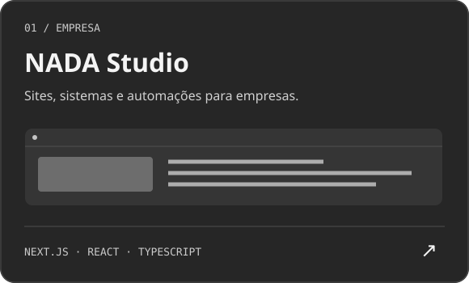
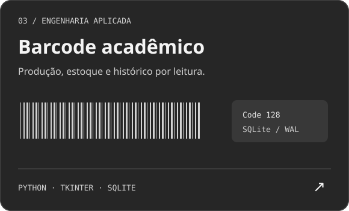
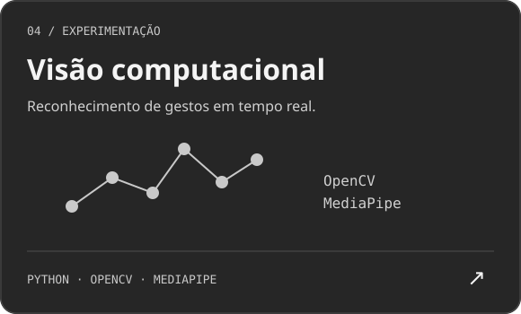
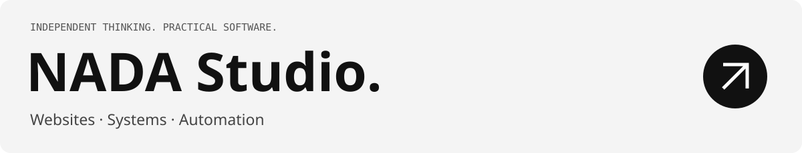

<picture>
  <source media="(prefers-reduced-motion: reduce)" srcset="assets/hero-static.png">
  
</picture>

  <a href="https://www.nadastudio.com.br"><strong>NADA STUDIO ↗</strong></a>
  &nbsp;&nbsp; / &nbsp;&nbsp;
  <a href="#projetos-selecionados"><strong>PROJETOS</strong></a>
  &nbsp;&nbsp; / &nbsp;&nbsp;
  <a href="https://github.com/nada-studio-br"><strong>EMPRESA NO GITHUB</strong></a>

## O processo é meu ponto de partida.

Sou **João Paulo**, profissional de Engenharia de Processos, estudante de Engenharia de Produção e fundador da **NADA Studio**, em Jundiaí–SP.

Meu trabalho começa entendendo a operação: quem executa, onde trava e o que precisa mudar. A partir disso, desenvolvo **sistemas, automações e experiências digitais** para produção, gestão e negócios.

**Na engenharia**, trabalho com melhoria de processos, desenho técnico, dispositivos, qualidade e rastreabilidade. **No software**, transformo esse contexto em aplicações que as pessoas conseguem usar no dia a dia.

## Projetos selecionados

 

<strong>▶ Veja o barcode acadêmico funcionando</strong>

 

[Documentação, instalação e capturas reais →](https://github.com/HSHAKOA/barcode-python-academico#readme)

<strong>＋ Mais projetos públicos</strong>

- **[MarkItDown Converter](https://github.com/HSHAKOA/markitdown-converter)** — conversão de documentos para Markdown usando MarkItDown.
- **[Vitrine Esporte](https://github.com/HSHAKOA/vitrine-esporte)** — template de catálogo esportivo da NADA Studio.
- **[Salute Sports](https://github.com/HSHAKOA/salute-sports-site)** — catálogo com pedido via WhatsApp.

## Onde aplico o que construo

| Na operação industrial | No negócio digital |
| :--- | :--- |
| Planejamento e controle de produção | Sites e sistemas para empresas |
| Extrusão de PVC e rastreabilidade | Agendamentos e fluxos de atendimento |
| Qualidade e gestão APQP/PPAP | Integrações e automação de tarefas |
| Desenho técnico, dispositivos e gabaritos | Mensuração, dados e conversão |

Parte desses projetos permanece privada por envolver operações internas e trabalhos de clientes.

## Meu ambiente de trabalho

**DESENVOLVIMENTO WEB**  
`TypeScript` `JavaScript` `React` `Next.js` `HTML` `CSS`

**AUTOMAÇÃO · DADOS · INFRAESTRUTURA**  
`Python` `Node.js` `PostgreSQL` `SQLite` `Supabase` `n8n`  
`APIs REST` `Cloudflare Workers` `Vercel` `Git` `GitHub`

**ENGENHARIA · ANÁLISE · VISÃO COMPUTACIONAL**  
`SolidWorks` `AutoCAD` `Power BI` `OpenCV` `MediaPipe`

Uso IA no desenvolvimento e na automação, acompanhada de **revisão, testes e documentação**.

---

<a href="https://www.nadastudio.com.br"><strong>Conheça os serviços e converse sobre seu projeto ↗</strong></a>

Licenças: o transcritor utiliza Apache-2.0. Consulte as condições de cada repositório antes de reutilizar código ou materiais. Marcas e materiais de clientes seguem seus respectivos direitos.
