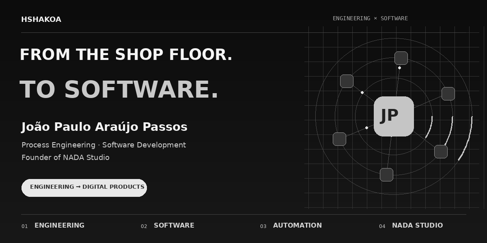
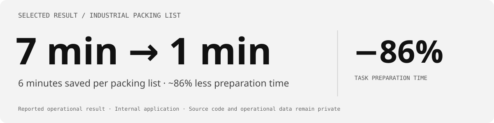
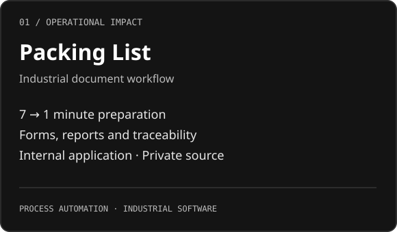
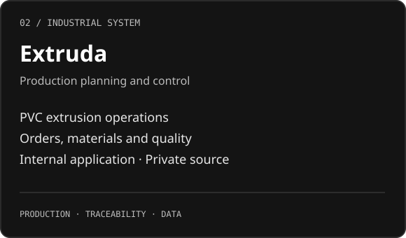
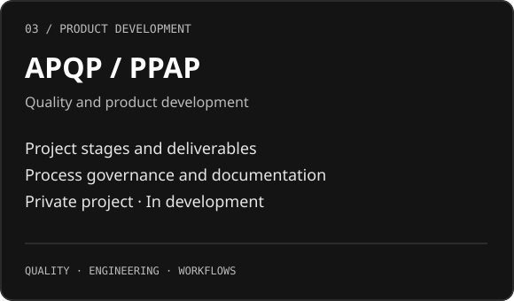
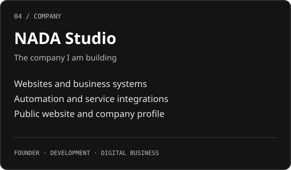
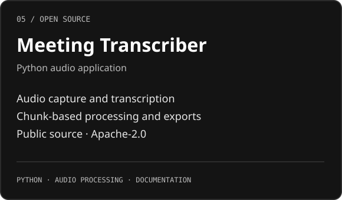
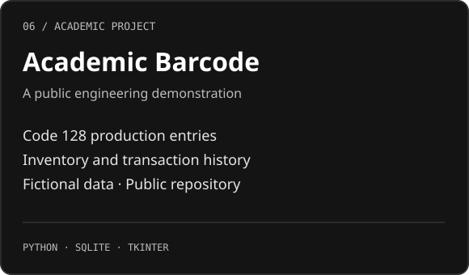

<picture><source media="(prefers-reduced-motion: reduce)" srcset="assets/v3-hero-static.png"></picture>

<a href="https://github.com/HSHAKOA/HSHAKOA#readme"><strong>ENGLISH</strong></a> &nbsp; / &nbsp; <a href="https://github.com/HSHAKOA/HSHAKOA/blob/main/README.pt-BR.md"><strong>PORTUGUÊS</strong></a>

<a href="mailto:passosjoao@outlook.pt">EMAIL ↗</a> &nbsp;·&nbsp; <a href="https://www.linkedin.com/in/jo%C3%A3o-paulo-ara%C3%BAjo-passos-0568b9257">LINKEDIN ↗</a> &nbsp;·&nbsp; <a href="https://www.nadastudio.com.br">NADA STUDIO ↗</a> &nbsp;·&nbsp; Jundiaí, SP · Brazil

## Experiência de processo. Software aplicado.

Sou **João Paulo Araújo Passos**, profissional de **Engenharia de Processos**, estudante de **Engenharia de Produção** e fundador da **NADA Studio**, em **Jundiaí–SP**.

Atuo entre a operação industrial e o desenvolvimento de software: entendo o fluxo, identifico tarefas repetitivas e construo ferramentas para produção, qualidade, rastreabilidade e gestão. Minha experiência inclui desenho técnico, apoio à fabricação, análise de dados, aplicações web e automação.

## Resultado em destaque

**Packing List — de uma rotina manual para uma aplicação interna.** O tempo de preparação informado passou de **7 para 1 minuto por packing list**: **6 minutos economizados por documento**, equivalente a **85,7% de redução no tempo dessa tarefa**. Esse resultado se refere à preparação do documento, sem extrapolação para a produtividade da fábrica.

O case público apresenta o resultado. Código, documentos internos, informações de clientes e registros operacionais permanecem privados.

## Projetos selecionados

 

 

| Projeto | Minha contribuição | Acesso público |
| :--- | :--- | :--- |
| **Packing List** | Preparação de documentos industriais, relatórios e rastreabilidade; **7 → 1 minuto por documento** | Somente resumo do resultado |
| **Extruda** | Planejamento e controle da produção para extrusão de PVC, ordens, materiais e qualidade | Somente resumo do escopo |
| **APQP / PPAP** | Fluxos de engenharia e qualidade, etapas, entregáveis e documentação | Somente resumo do escopo; em desenvolvimento |
| **NADA Studio** | Construção da empresa, sites, sistemas, integrações e automações | [Site](https://www.nadastudio.com.br) · [Organização no GitHub](https://github.com/nada-studio-br) |
| **Transcritor de reuniões** | Captura e transcrição de áudio em Python, processamento em blocos e exportações | [Código e documentação](https://github.com/HSHAKOA/Agente-de-transcrito-de-reuni-es-) |
| **Barcode acadêmico** | Apontamento Code 128, estoque e histórico com dados fictícios | [Código e demonstração](https://github.com/HSHAKOA/barcode-python-academico) |

## Competências e ferramentas

| Área | Competências e ferramentas |
| :--- | :--- |
| **Engenharia de processos** | Mapeamento, padronização, melhoria contínua, rotinas de produção e rastreabilidade |
| **Projeto mecânico e fabricação** | SolidWorks, AutoCAD, desenho técnico, dispositivos, gabaritos, CNC, impressão 3D e try-outs de ferramentais |
| **Qualidade e desenvolvimento de produto** | Fluxos APQP/PPAP, conceitos de FMEA, instruções de trabalho, validação e documentação técnica |
| **Desenvolvimento web e aplicações** | TypeScript, JavaScript, React, Next.js, HTML, CSS, Node.js e Python |
| **Bancos de dados e integrações** | PostgreSQL, SQLite, Supabase, APIs REST, webhooks e n8n |
| **Dados e visão computacional** | Power BI, indicadores operacionais, OpenCV e MediaPipe |
| **Entrega e infraestrutura** | Git, GitHub, Cloudflare Workers, Vercel, testes automatizados e versionamento |
| **Negócios digitais e marketing** | Conversão em sites, Google Ads, Meta Ads, GA4, mensuração e análise de campanhas |
| **IA aplicada** | Automação de fluxos, desenvolvimento assistido por IA, elaboração de prompts, revisão e testes |

Combino conhecimento do processo com implementação. A IA apoia o trabalho; análise de engenharia, revisão de código, testes e documentação fazem parte da entrega.

## Conquistas profissionais e no GitHub

- **Melhoria operacional:** preparação de packing list reduzida de **7 para 1 minuto**.
- **Empreendedorismo:** fundador da **NADA Studio**, desenvolvendo sites, sistemas e automações para empresas.
- **Código aberto:** transcritor de reuniões em **Python com licença Apache-2.0**.
- **Engenharia acadêmica:** demonstração pública de barcode e estoque com dados fictícios.
- **Conquista do GitHub:** [YOLO](https://github.com/HSHAKOA?achievement=yolo&tab=achievements). [Ver conquistas nativas do GitHub →](https://github.com/HSHAKOA?tab=achievements)

## Laboratório público

<strong>Experimentos e projetos complementares</strong>

- [Reconhecimento de gestos](https://github.com/HSHAKOA/reconhecimento-gestos-python) — visão computacional em tempo real com OpenCV e MediaPipe.
- [MarkItDown Converter](https://github.com/HSHAKOA/markitdown-converter) — conversão de documentos para Markdown.
- [Vitrine Esporte](https://github.com/HSHAKOA/vitrine-esporte) — template de catálogo esportivo.
- [Salute Sports](https://github.com/HSHAKOA/salute-sports-site) — catálogo com pedido via WhatsApp.

---

## Vamos construir uma solução útil?

**Projetos para empresas · Software industrial · Automação · Desenvolvimento web**

**E-mail:** [passosjoao@outlook.pt](mailto:passosjoao@outlook.pt)  
**LinkedIn:** [João Paulo Araújo Passos](https://www.linkedin.com/in/jo%C3%A3o-paulo-ara%C3%BAjo-passos-0568b9257)  
**Empresa:** [nadastudio.com.br](https://www.nadastudio.com.br)  
**Localização:** Jundiaí, São Paulo, Brasil

Licenças: o transcritor utiliza Apache-2.0. Cada repositório tem suas próprias condições; consulte a licença antes de reutilizar. Este perfil não concede direitos sobre aplicações privadas, marcas ou materiais de clientes.
